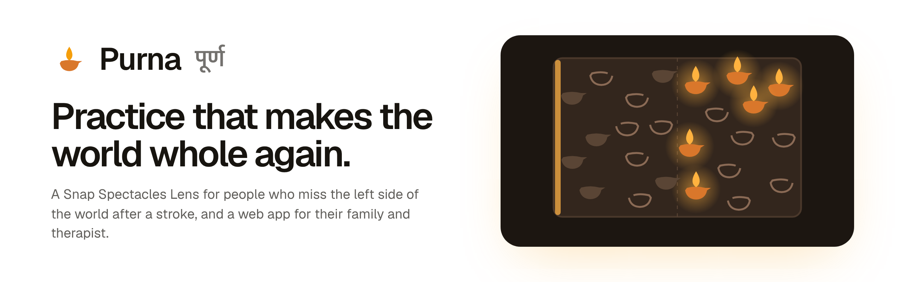
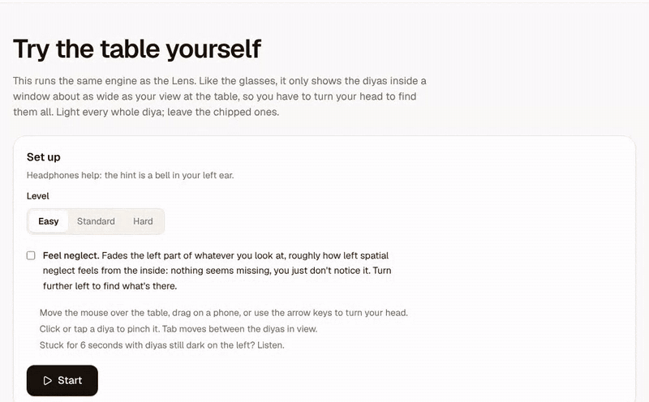
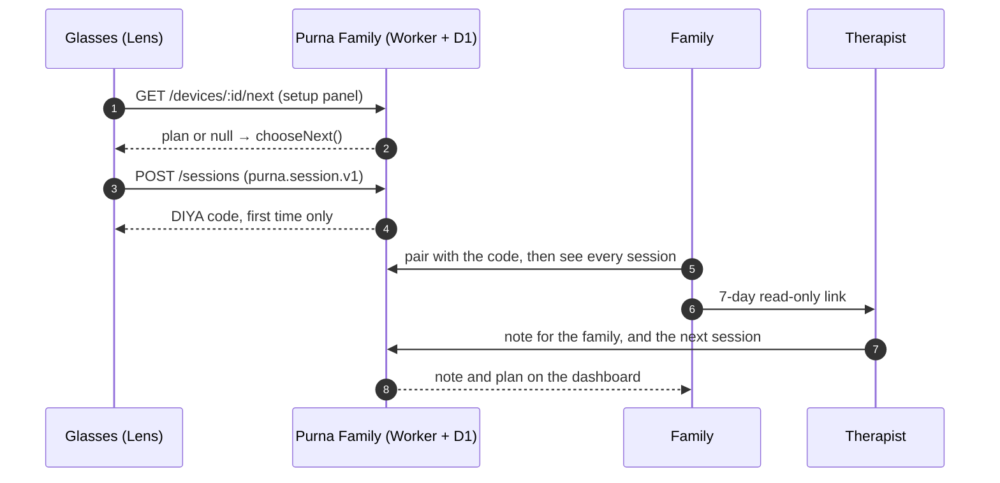
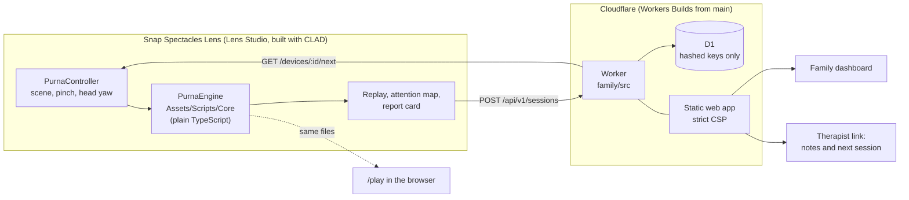

<div align="center">

<a href="https://purna.dualmindlab.tech">
  <picture>
    <source media="(prefers-color-scheme: dark)" srcset="docs/img/banner-dark.png">
    
  </picture>
</a>

[](https://github.com/harshbhx/purna/actions/workflows/ci.yml)
[](https://github.com/harshbhx/purna/actions/workflows/live.yml)
[](https://purna.dualmindlab.tech)


[](ACCESSIBILITY.md)
[](LICENSE)


<br>

[](https://purna.dualmindlab.tech/play)
[](https://purna.dualmindlab.tech/doctor#demo)
[](https://purna.dualmindlab.tech/docs#safety)

**[For judges](JUDGES.md)** · [What's new here](#what-no-one-else-does) · [How a session works](#a-session-start-to-finish) · [The measures](#what-it-measures) · [How it's built](#how-its-built) · [Tests](#tests) · [Docs](https://purna.dualmindlab.tech/docs)

</div>

> [!IMPORTANT]
> Purna is a practice tool, not a medical device. It doesn't diagnose or treat, and no regulator anywhere has reviewed it. Before using it, read the **[safety guide](https://purna.dualmindlab.tech/docs#safety)**. If you think someone is having a stroke, call your local emergency number now.

## The problem

After a stroke on the right side of the brain, many people stop noticing the left half of space. They eat half the plate, read half the page and bump the left door frame, and usually don't know it.[^neglect] This is **left spatial neglect**. Therapists train it with paper "cancellation" sheets in the clinic, but paper can't see where your head turns, and many survivors rarely see a therapist at all: in one multicentre study in India, only 7.6% got occupational therapy.[^inspire]

**Purna** (पूर्ण, "whole") moves that exercise onto the person's own dining table. Through Snap Spectacles, clay **diyas** appear on the table. You light the whole ones with a pinch and leave the chipped ones. Stall on the right, and a temple bell rings **from your left**. **The hint points to the side, never to the answer.** At the end, a glowing thread replays your search and warm light shows where your head pointed, so the half you skipped becomes visible. One pinch sends the report home.

<div align="center">
<a href="https://purna.dualmindlab.tech/play"></a>
<br><sub><b>Try it yourself:</b> the same engine as the Lens, in your browser. Only the diyas inside your view show, so you have to turn. <a href="https://purna.dualmindlab.tech/play">purna.dualmindlab.tech/play</a></sub>
</div>

## What no one else does

| | |
|---|---|
| 🪔 **Play it without glasses** | Judges and families can't all wear Spectacles, so [**/play**](https://purna.dualmindlab.tech/play) runs the Lens's own engine in a browser: a view as narrow as the glasses' (about 37 cm of a 70 cm table), turned with the mouse or arrow keys, the bell in your left ear, then your replay and report. **Feel neglect** fades the left of whatever you look at, so a son or daughter can feel what their father can't see. |
| 🔦 **An attention map on the real table** | After the replay, the Lens paints warm light where the head pointed during the task, strip by strip. The side never looked at stays dark. Paper and tablets only know where you tapped; glasses know where you looked. The same map appears on every replay on the family site. |
| 🩺 **The therapist sets the next session** | From a 7-day read-only link, the therapist picks the next level and hint delay. The glasses load it on the setup panel once ("Set by your therapist on 3 Dec"), the family sees it, and the next session clears it. Without a plan, the glasses suggest the next step themselves. |
| ◐ **Two kinds of neglect from one table** | Chipped diyas with the gap on a known side separate "my left" from "each object's left", after the Ota and Apples cancellation tests.[^ota] The [patient bench](#does-it-measure-what-it-should) proves the report tells them apart. |

## A session, start to finish

1. A carer puts the glasses on and picks a level. The panel suggests one, from the therapist or from the last sessions. It reminds them: *sit down, with someone nearby.* Sharing is **off** unless they turn it on.
2. Whole and chipped diyas appear across the real table: 12 + 12 on Standard, half left, half right.
3. Pinch a whole diya and it lights. Pinch a chipped one and nothing happens but a soft tick. No score, no timer, no failure sound.
4. **Stuck for 6 s** with dark diyas still on the left: the bell rings from the left edge and the beam pulses. **6 s more:** the beam sweeps left. The beam fades as the person stops needing it.
5. The **replay** draws the search path; the **attention map** lights where the head pointed; the **report card** shows four measures in plain words, with "Practice result, not a diagnosis."
6. **Send to family** posts the session. New glasses show a code like `DIYA-7K3P` for the family to type once.



> [!TIP]
> Every number on this page comes from code you can run: `cd tools && npm test` for the engine and the bench, `cd family && npm test` for the server. See [Tests](#tests).

## What it measures

The report follows published cancellation-test scoring, from a pinch log and head yaw on real furniture:

| Measure | What it catches |
|---|---|
| **Left vs right** | Whole diyas found on each half of the table |
| **Chipped diyas** | Diyas lit by mistake, by the side of their gap: missing the left of *objects* |
| **Search order** | How tidy the search was (0 scattered, 1 row by row), path crossings, revisits |
| **Head turn** | How far left the head turned, and where it pointed (the attention map) |

<details>
<summary><b>For therapists: the definitions</b></summary>

Centre of Cancellation, after Rorden and Karnath,[^coc] over the $n$ lit whole diyas at positions $x_i$ on a table whose usable edges are $x_{min}$ and $x_{max}$:

$$\mathrm{CoC} = \frac{1}{n}\sum_{i=1}^{n}\left(\frac{2\,(x_i - x_{min})}{x_{max} - x_{min}} - 1\right)$$

$-1$ to $+1$; positive means the diyas found lean right. Egocentric asymmetry is $\frac{R - L}{R + L}$ over whole diyas found; allocentric asymmetry is chipped-on-left minus chipped-on-right lit by mistake.

The attention map splits the 70 cm table into 14 strips of 5 cm. A head yaw $\theta$ (positive = left) points at $x = -65\tan\theta$ cm on the table's centre line; each strip's value is its share of the table task's yaw samples (10 a second).

Published cut-offs come from paper tests with more targets, so the therapist view shows them as context, never as a pass/fail line.[^cutoffs] Full definitions: [what the numbers mean](https://purna.dualmindlab.tech/docs#measures).

</details>

## Does it measure what it should?

The **patient bench** drives the real engine with three scripted searchers on 200 layouts each. The report tells them apart: the left-neglect searcher finds fewer left diyas, needs hints and turns left less; the object-neglect searcher finds every whole diya but lights chipped-on-left ones.


> [!NOTE]
> These are **simulated players, not patients.** The bench proves the measures separate search styles; it says nothing yet about real people. On the same bench, the attention map puts the left-neglect searcher's gaze on the left half far less than the healthy searcher's (a test checks it on 40 layouts).

<table>
<tr>
<td width="42%" valign="top">

**The family loop**, on a phone: pair with the code from the glasses, see the sessions, open one.


</td>
<td width="58%" valign="top">

**The therapist view**: every session's numbers, the trend with its day-to-day band, where the time went, published references as context, and **Set the next session**.


</td>
</tr>
</table>

## For judges

**Start with [JUDGES.md](JUDGES.md)**: a one-minute summary, a two-minute tour, the evidence for each criterion, honest status, and answers to the questions you'll likely have.

<details>
<summary><b>Where each judging criterion is answered</b></summary>

| Criterion | Evidence |
|---|---|
| **Stage One** | Planned with plan-lens ([answers](devpost/plan-lens-answers.md), [brief](devpost/design-brief.md)); built with CLAD and the Lens Studio MCP ([prompts](docs/05-PROMPTS.md)); LEAF scenarios in `Assets/Tests` |
| **Design** | One spatial moment done well: stuck, a bell from the left, the head turns. Layout in centimetres for a seated person; colours for an additive display; no score, timer or failure sound; nothing changes brightness more than three times a second ([design](docs/02-DESIGN.md)) |
| **Technical** | One engine in plain TypeScript for the Lens, Node and the browser, 99.0% covered; a contract test that every session the engine can produce passes the server; rate limits, hashed keys, a strict CSP, daily retention clean-up; 283 tests on every pull request ([testing](docs/06-TESTING.md)) |
| **Innovation** | The attention map, the therapist's next session, the browser table with Feel neglect, chipped diyas for object-centred neglect ([research](docs/10-RESEARCH.md)) |
| **Presentation** | This page, [JUDGES.md](JUDGES.md), the [Devpost story](devpost/STORY.md), the video, a live site with labelled examples and [docs](https://purna.dualmindlab.tech/docs) |

</details>

**Status, honestly**

- [x] Core logic: layout, hints, beam fading, metrics, attention map, report, next-session choice (**logic proven**, 79 tests, 99.0% lines)
- [x] Measures separate three search styles on simulated players (**logic proven**, not yet on patients)
- [x] Purna Family: site, API, database, therapist view, plan, browser table, docs; live, WCAG 2.1 AA checked in light and dark, family dashboard in English or Hindi
- [ ] The Lens scene in Lens Studio, built by CLAD (in progress; LEAF results land here)
- [ ] How it feels to a stroke survivor (**feel unproven**; not yet tried with patients or therapists)

## How it's built



- **One engine, three homes.** `Assets/Scripts/Core` has no Lens Studio globals. The Lens calls it every frame, Node tests run the same files, and `/play` runs it in the browser.
- **One contract.** Sessions are [`purna.session.v1`](docs/03-ARCHITECTURE.md#5-data-contract-purnasessionv1), validated field by field. A contract test runs the engine through every level and add-on against the server's validator.
- **Private by default.** The glasses send no identity; the family types a name. Keys and doctor tokens are stored only as SHA-256 hashes; doctor links expire; unpaired data is deleted after 30 days; "Delete everything" removes it all. The browser table sends nothing.
- **The web app** is React with [shadcn/ui](https://ui.shadcn.com), [React Bits](https://reactbits.dev) and effects in the style of [Aceternity UI](https://ui.aceternity.com), built with Vite and Tailwind into static files the same Worker serves. Light and dark follow your system, or the switch in the header. Credits: [`family/THIRD_PARTY.md`](family/THIRD_PARTY.md).
- **Shipping.** Cloudflare Workers Builds deploys every push to `main` (no keys in GitHub); [`live.yml`](.github/workflows/live.yml) checks the live site after each push and daily.

## Tests

<details>
<summary><b>283 automated tests on every pull request</b> (click for what each suite proves)</summary>

| Suite | Command | Tests | What it proves |
|---|---|---|---|
| Core, bench, sounds | `cd tools && npm test` | 79 | Layout rules on 500 seeds × 3 levels, hint timing, beam fading, metrics, the attention map, the engine's phases, the patient bench, the next-session choice with and without a therapist plan, and each sound against the design spec. Coverage gate 85% (now 99.0%) |
| Worker + local D1 | `cd family && npm test` | 84 | Every API route and error, field-by-field validation (attention map included), crypto, the engine → server contract, rate limits, retention clean-up, and the therapist plan from doctor link to glasses |
| Web app | `npm run test:web` | 71 | Components in jsdom: the night table, replay and attention map, dashboards, the therapist view and its plan form, CSV safety, the docs pages, Hindi, the theme switch, and the browser table on the real engine |
| End to end | `npm run test:e2e` | 49 × 2 | Real Chrome on phone and desktop against the production build: every family and therapist flow, the plan, the browser table, the theme switch, a keyboard-only walk, and axe WCAG 2.1 AA scans of every screen in light and dark |

**CI** ([`ci.yml`](.github/workflows/ci.yml)) runs all of it, builds the web app, puts coverage in the job summary, lints the shell scripts, and fails if the bench chart or demo data are stale.

</details>

<details>
<summary><b>Run it yourself</b></summary>

```bash
# Core logic and the patient bench
cd tools && npm ci && npm test

# Purna Family on http://localhost:8787
cd family && npm ci
npx wrangler d1 migrations apply purna --local
npm run dev            # builds the React app, then wrangler dev
npm run sample -- --post http://localhost:8787 0123456789abcdef0123456789abcdef   # prints a DIYA code
```

Then open <kbd>localhost:8787/play</kbd> to try the table, or pair with the printed code.

</details>

<details>
<summary><b>Repo map</b></summary>

| Path | What |
|---|---|
| [`Assets/Scripts/Core/`](Assets/Scripts/Core) | The engine: layout, hints, metrics, attention map, report, next session |
| [`Assets/Audio/`](Assets/Audio) | Purna's sounds, synthesised in code and tested |
| [`tools/`](tools) | Core tests, the patient bench, the bench chart, the sound generator |
| [`family/`](family) | Purna Family: Worker (`src/`), D1 migrations, React web app (`web/`), docs pages (`web/src/content/docs`), all its tests |
| [`devpost/`](devpost) | The plan-lens answers, the design brief CLAD builds from, the Devpost story and the video script |
| [`docs/`](docs) | [PRD](docs/01-PRD.md) · [design](docs/02-DESIGN.md) · [architecture](docs/03-ARCHITECTURE.md) · [tasks](docs/04-TASKS.md) · [prompts](docs/05-PROMPTS.md) · [testing](docs/06-TESTING.md) · [submission](docs/07-SUBMISSION.md) · [live review](docs/08-LIVE-REVIEW.md) · [research](docs/10-RESEARCH.md) |

</details>

## Community

| | |
|---|---|
| ♿ [Accessibility](ACCESSIBILITY.md) | What we check, what we know isn't perfect, and how to tell us |
| 🔒 [Security](SECURITY.md) | Report a problem privately |
| 🤝 [Contributing](CONTRIBUTING.md) · [Code of conduct](CODE_OF_CONDUCT.md) | How to help, and how we treat each other |
| 💬 [Support](SUPPORT.md) | Where to ask for help (not for medical advice) |
| 📚 [Cite Purna](CITATION.cff) | GitHub's "Cite this repository" uses it |

MIT © 2026 Harsh Bhanushali · [DualMind Labs](https://dualmindlab.tech)

<div align="center">
<br>
<a href="https://purna.dualmindlab.tech/play"></a>
</div>

[^neglect]: Neglect follows roughly 40% of right-hemisphere strokes. Sources for every claim are in [`docs/10-RESEARCH.md`](docs/10-RESEARCH.md) (rows P1–P2).
[^inspire]: INSPIRE, a multicentre Indian stroke study: 76% got physiotherapy and 7.6% occupational therapy ([research row I2](docs/10-RESEARCH.md)).
[^ota]: Ota's cancellation test and the Apples test use shapes with a gap on the left or right ([research rows M1–M2](docs/10-RESEARCH.md)).
[^coc]: Rorden and Karnath 2010 ([research row M7](docs/10-RESEARCH.md)).
[^cutoffs]: Fixed cut-offs give false positives that depend on how many targets were cancelled ([research row M8](docs/10-RESEARCH.md)).
