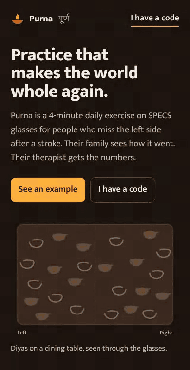
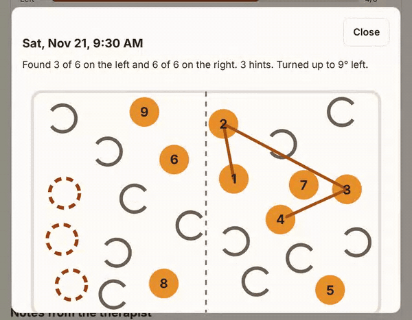
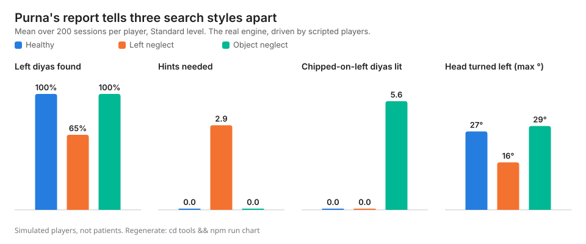
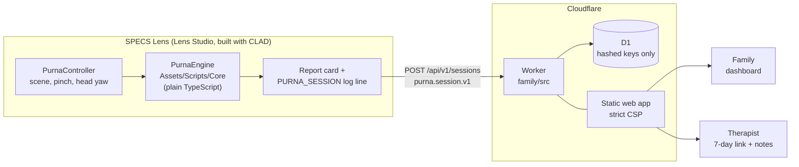
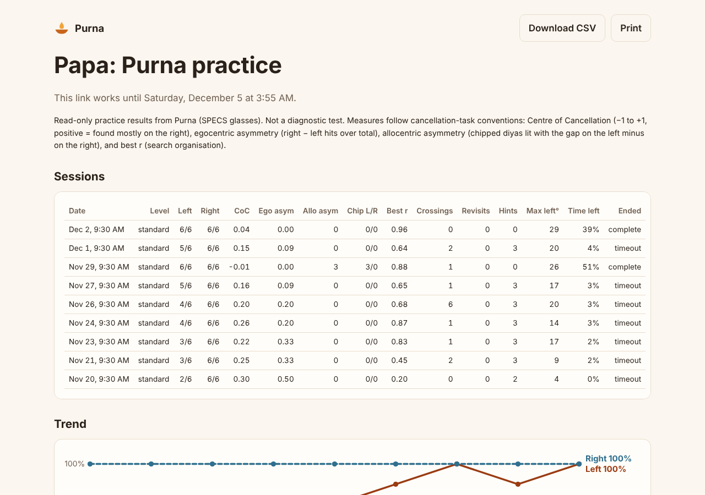

<div align="center">


# Purna

**Practice that makes the world whole again.**

A SPECS Lens for people who miss the left side of the world after a stroke,<br>and a family web app that carries every session to their children and their therapist.

[](https://github.com/harshbhx/purna/actions/workflows/ci.yml)
[](https://github.com/harshbhx/purna/actions/workflows/deploy.yml)


[](LICENSE)

[purna.dualmindlab.tech](https://purna.dualmindlab.tech) · Built for **Learn AR with SPECS, Round 2** · [Why it's built this way](docs/10-RESEARCH.md)

</div>

---

After a right-hemisphere stroke, many people stop noticing the left half of space. They eat half the plate, read half the page, and bump the left door frame, without knowing it. This is called **left spatial neglect**. Therapists train it with paper "cancellation" sheets in the clinic, but in one multicentre Indian study only 7.6% of stroke survivors got occupational therapy, and paper can't see where your head turns.

**Purna** (पूर्ण, "whole") moves that exercise onto the dining table at home. Through Snap SPECS, small clay **diyas** appear on the table. You light the whole ones with a pinch and leave the chipped ones alone. If you stay on the right too long, a temple bell rings from your left and a soft beam sweeps that way. **The hints point to the side, never to the answer.** When you finish, a glowing thread replays the path your search took, so the half you skipped becomes visible. One pinch sends the report home.

**Purna Family** lets their children follow along: a plain-language card for each session, a trend over days, and a 7-day read-only link for the therapist, who can write a note back.

> [!IMPORTANT]
> Purna is a practice tool, not a medical device. It doesn't diagnose or treat.

<table>
<tr>
<td width="40%" valign="top">

**The family loop**, on a phone: pair with the code from the glasses, see the sessions, open one.



</td>
<td width="60%" valign="top">

**The replay**: numbers are the order the diyas were found; dashed circles were missed; open rings are chipped diyas.



</td>
</tr>
</table>

## A session, start to finish

1. A carer puts the glasses on and picks a level (Easy, Standard, Hard). Sharing is **off** unless they turn it on.
2. Whole and chipped diyas appear across the real table: 12 + 12 on Standard, split exactly half left, half right. Every chipped diya has its gap on one side, half on the left and half on the right.
3. Pinch a whole diya and it lights. Pinch a chipped one and nothing happens except a soft tick.
4. **Stuck for 6 s** with dark diyas still on the left: the bell rings from the left edge and the beam pulses. **6 s more:** the beam sweeps left. The beam fades as the person starts finding left diyas without help.
5. The **replay** draws the search path, then a **report card** shows four measures in plain words, with "Practice result, not a diagnosis."
6. **Send to family** posts the session. New glasses show a code like `DIYA-7K3P` for the family to type once.

Add-ons, if time allows: a warm-up with diyas drifting **leftward only** (moving things rightward can make neglect worse), and a far board 2 m away.

## Why it's built this way

Every choice traces to a finding in [`docs/10-RESEARCH.md`](docs/10-RESEARCH.md). The short version:

| Choice | Because |
|---|---|
| **Chipped** diyas to ignore | Neglect can be about each object's left side, not only yours. Cancellation tests like Ota's use shapes with a gap on the left or right to tell the two apart (M1) |
| A **replay** of the search path | People with neglect often don't know they missed anything (P3). Showing patients where they looked during search improved neglect and self-awareness in a crossover study (P4) |
| Warm-up moves **leftward only** | Leftward smooth pursuit reduces neglect, while rightward may worsen it (E3). A unit test enforces the direction |
| Family sees **results**, not a coaching role | Family-led rehab in India didn't reduce death or dependency in the ATTEND trial (I5). Purna gives the family visibility and the therapist the numbers |
| Clinical measures, honestly labelled | Egocentric and allocentric asymmetry follow the Apples test's scoring (M2); the evidence that neglect training changes daily life is still uncertain (E2), so Purna says "practice", never "treatment" |
| Hints point to the **side**, never at a diya | Our design choice: the searching is the exercise, so a hint that points at the answer would do the work for them |

Codes in brackets are rows in the research doc, each with its source.

## Does it measure what it should?

The **patient bench** drives the real engine with three scripted searchers on 200 layouts each. Purna's report tells them apart: the left-neglect searcher finds fewer left diyas, needs hints and turns left less; the object-neglect searcher finds every whole diya but lights chipped-on-left ones.



These are **simulated players, not patients**. The bench proves the measures separate search styles; it says nothing yet about real people.

## For judges

| Criterion | Where to look |
|---|---|
| **Design** | One spatial moment done well: stuck, a bell from the left, the head turns. Layout in cm for a seated person, colours for an additive display, no score or timer during the task ([design](docs/02-DESIGN.md)) |
| **Technical** | Logic in plain TypeScript shared by the Lens and Node, 98.9% covered; LEAF tests planned for every done criterion, with a head-yaw override; a contract test that every session the engine can produce passes the server; CI and CD on every merge |
| **Innovation** | Cancellation-test measures from a pinch log and head yaw on real furniture; object-centred neglect with chipped diyas; a replay that shows the person their own blind half |
| **Presentation** | The [brief](devpost/design-brief.md) from plan-lens, the [research](docs/10-RESEARCH.md), the video, and a live family site with a labelled example |

**Status, honestly:**

| Part | State |
|---|---|
| Core logic: layout, hints, beam fading, metrics, report | ✅ logic proven (47 tests) |
| Purna Family: API, database, web app, doctor view | ✅ works end to end in Chrome (106 tests) |
| Lens scene in Lens Studio (CLAD) | 🛠️ in progress; LEAF results land here |
| How it feels to a real stroke survivor | ❓ feel unproven, not tested with patients |

## How it's built



- **One engine, two homes.** `Assets/Scripts/Core` has no Lens Studio globals. The Lens calls it every frame; Node tests run the same files.
- **One contract.** The session JSON is [`purna.session.v1`](docs/03-ARCHITECTURE.md#5-data-contract-purnasessionv1). The Worker validates every field and size.
- **Private by default.** The glasses send no identity; the family types a name. Family keys and doctor tokens are stored only as SHA-256 hashes; doctor links expire and can be revoked; "Delete everything" removes it all.



## Tests and CI/CD

| Suite | Command | What it proves |
|---|---|---|
| Core + patient bench | `cd tools && npm test` | Layout rules on 500 seeds × 3 levels, hint timing, beam fading, metrics, the engine's phases, the bench (47 tests, coverage gate 85%) |
| Worker + local D1 | `cd family && npm test` | Every API route and error, field-by-field validation, crypto, and the engine → server contract over every preset and add-on (68 tests) |
| Browser code | `npm run test:web` | Replay and trend SVGs, CSV export with formula-injection guards, the API client, text-only DOM helpers (30 tests) |
| End to end | `npm run test:e2e` | Real Chrome against `wrangler dev`: pair, dashboard, replay, doctor link, CSV, note, invite, import, delete, on phone and desktop (8 tests × 2) |

**CI** ([`ci.yml`](.github/workflows/ci.yml)) runs all of it on every pull request, puts coverage in the job summary, lints the shell scripts, and fails if the bench chart or demo data are stale. **CD** ([`deploy.yml`](.github/workflows/deploy.yml)) runs after CI passes on `main`: D1 migrations, `wrangler deploy`, then a smoke test of the live site.

## Run it yourself

```bash
# Core logic and the patient bench
cd tools && npm ci && npm test

# Purna Family on http://localhost:8787
cd family && npm ci
npx wrangler d1 migrations apply purna --local
npx wrangler dev
npm run sample -- --post http://localhost:8787 0123456789abcdef0123456789abcdef   # prints a DIYA code
```

## Repo map

| Path | What |
|---|---|
| [`devpost/`](devpost) | The plan-lens answers and the design brief CLAD builds from |
| [`docs/`](docs) | [PRD](docs/01-PRD.md) · [design](docs/02-DESIGN.md) · [architecture](docs/03-ARCHITECTURE.md) · [tasks](docs/04-TASKS.md) · [prompts](docs/05-PROMPTS.md) · [testing](docs/06-TESTING.md) · [research](docs/10-RESEARCH.md) |
| [`Assets/Scripts/Core/`](Assets/Scripts/Core) | The engine: layout, hints, metrics, report |
| [`tools/`](tools) | Core tests, the patient bench, the bench chart |
| [`family/`](family) | Purna Family: Worker, D1 migration, web app, all its tests |
| [`AGENTS.md`](AGENTS.md) | Rules for any coding agent working here |

Found a security problem? See [SECURITY.md](SECURITY.md).

## License

MIT © 2026 Harsh Bhanushali
