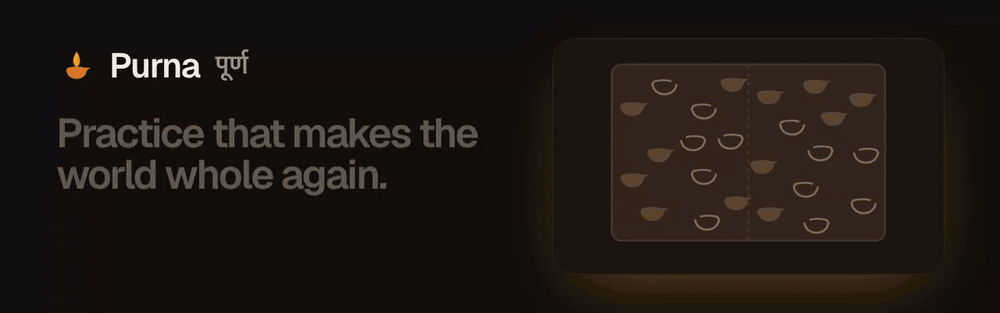
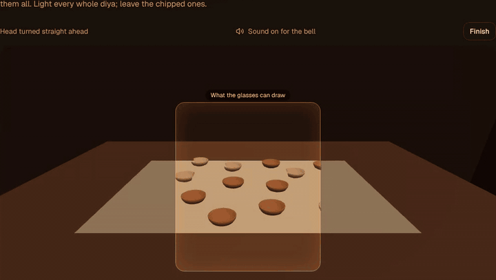
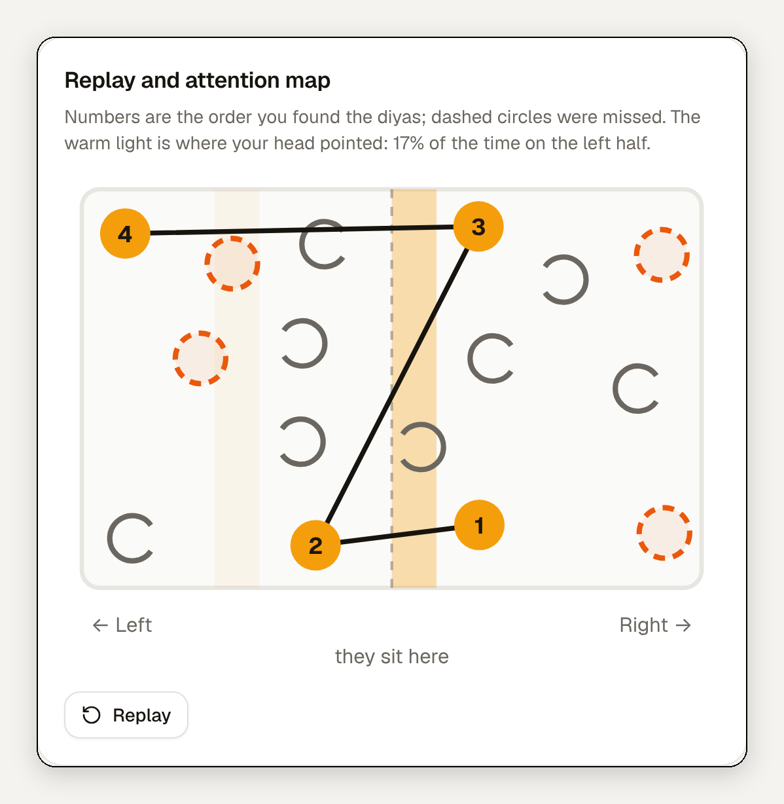
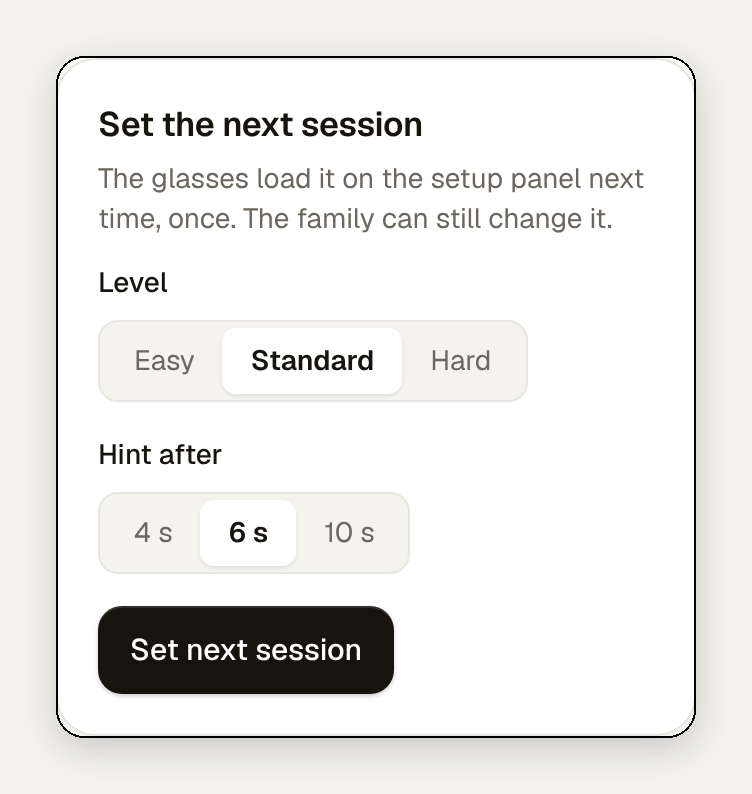
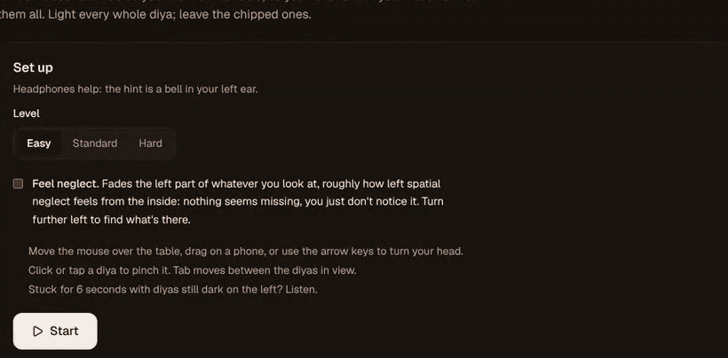
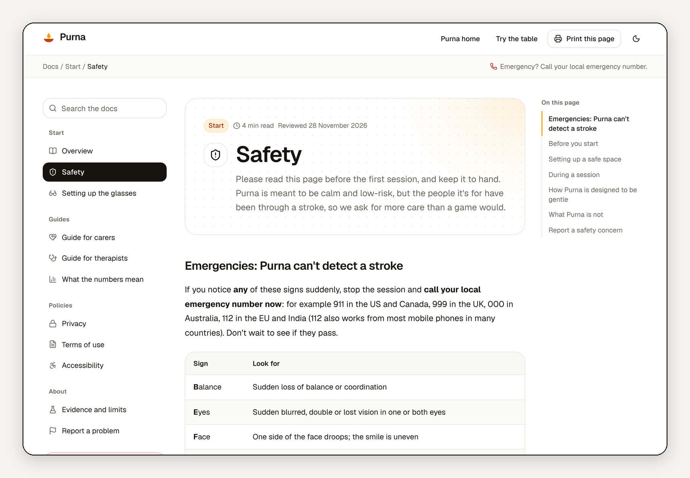
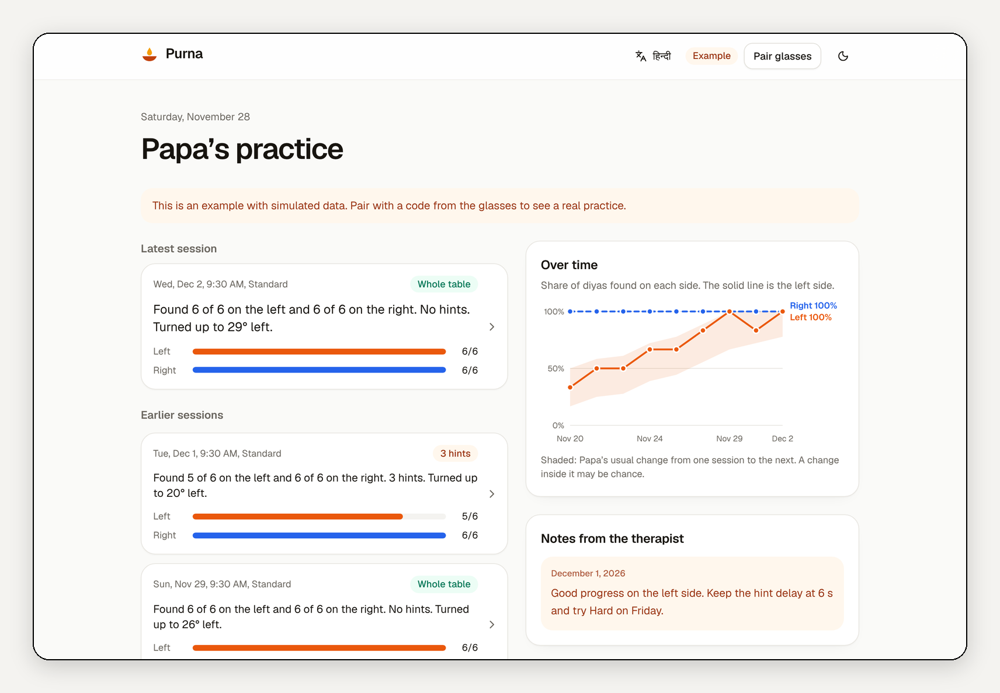
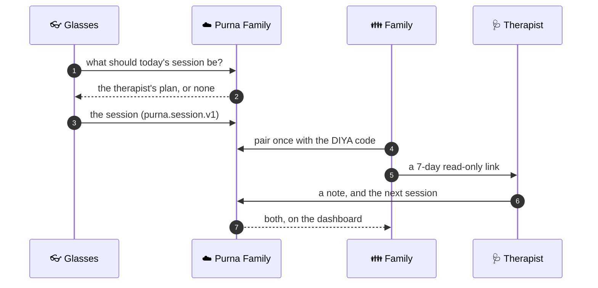
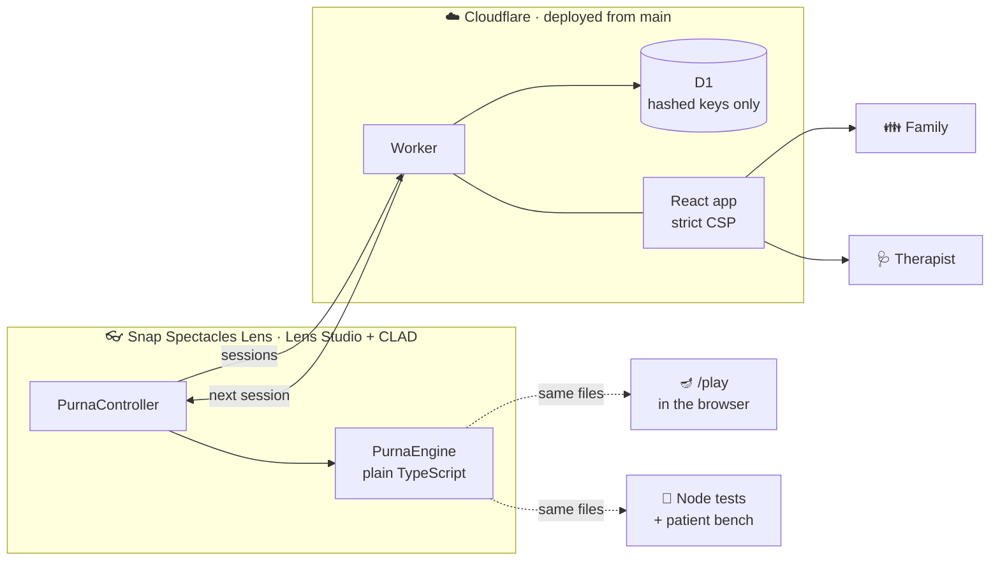
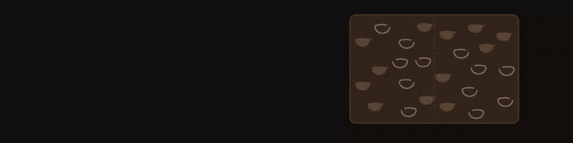

<div align="center">

<a href="https://purna.dualmindlab.tech"></a>

<br>

[](https://purna.dualmindlab.tech/play)
[](https://purna.dualmindlab.tech/doctor#demo)
[](https://purna.dualmindlab.tech/docs)

[](https://github.com/harshbhx/purna/actions/workflows/ci.yml)
[](https://github.com/harshbhx/purna/actions/workflows/live.yml)
[](https://purna.dualmindlab.tech)


[](ACCESSIBILITY.md)
[](LICENSE)

**[For judges](JUDGES.md)** &nbsp;·&nbsp; [Features](#-what-no-one-else-does) &nbsp;·&nbsp; [How it works](#-a-session-in-four-minutes) &nbsp;·&nbsp; [Numbers](#-by-the-numbers) &nbsp;·&nbsp; [Research](#-the-research-behind-it) &nbsp;·&nbsp; [Built with](#-how-its-built) &nbsp;·&nbsp; [Tests](#-tests) &nbsp;·&nbsp; [Accessibility](ACCESSIBILITY.md)

</div>

<br>

After a stroke on the right side of the brain, many people stop noticing the left half of the world. They eat half the plate and bump the left door frame, and don't know it. **Purna** (पूर्ण, *whole*) turns the therapist's paper exercise into lighting clay diyas on your own dining table through Snap Spectacles. Stall on the right and a temple bell rings **from your left**: the hint points to the side, never to the answer. Then your search is replayed on the table, and the half you skipped lights up.

> [!IMPORTANT]
> Purna is a practice tool, not a medical device. It doesn't diagnose or treat, and no regulator anywhere has reviewed it. Read the **[safety guide](https://purna.dualmindlab.tech/docs#safety)** first. If you think someone is having a stroke, call your local emergency number now.

<br>

<div align="center">
<a href="https://purna.dualmindlab.tech/play"></a>
<br>
<sub><b>No glasses needed.</b> A 3D dining room in your browser, on the same engine as the Lens. Diyas appear only inside the frame the glasses can draw, so you have to turn your head. <a href="https://purna.dualmindlab.tech/play"><b>Play it</b></a></sub>
</div>

<br>

## ✦ What no one else does

<table>
<tr>
<td width="50%" valign="top">

### 🔦 An attention map on your own table

After the replay, warm light fills the table where your head pointed. The side you never looked at stays dark. Paper and tablets only know where you tapped; glasses know where you looked.

<picture>
  <source media="(prefers-color-scheme: dark)" srcset="docs/img/readme/replay-dark.png">
  
</picture>

</td>
<td width="50%" valign="top">

### 🩺 The therapist sets the next session

From a 7-day read-only link, the therapist picks the next level and hint delay. The glasses load it once (*"Set by your therapist on 3 Dec"*), the family sees it, and the next session clears it.

<picture>
  <source media="(prefers-color-scheme: dark)" srcset="docs/img/readme/plan-dark.png">
  
</picture>

</td>
</tr>
<tr>
<td width="50%" valign="top">

### 🪔 Play it in 3D, and feel it

[**/play**](https://purna.dualmindlab.tech/play) puts you at the table through simulated Spectacles (three.js): the room is always there, the diyas only inside the display's frame. A top-down view works with screen readers. Tick **Feel neglect** and the left of whatever you look at fades away.



</td>
<td width="50%" valign="top">

### 📖 Docs that explain themselves

[Safety, setup, guides, results and research](https://purna.dualmindlab.tech/docs), searchable, in light and dark. Every medical or technical word has a dotted underline: point at it for its meaning, follow it to a [42-term glossary](https://purna.dualmindlab.tech/docs#glossary).

<picture>
  <source media="(prefers-color-scheme: dark)" srcset="docs/img/readme/docs-dark.png">
  
</picture>

</td>
</tr>
</table>

## ✦ A session in four minutes

| | | |
|:-:|---|---|
| **1** | **Set up** | A carer picks a level. The panel suggests one, from the therapist or from the last sessions, and reminds them: *sit down, with someone nearby.* |
| **2** | **Light the diyas** | Pinch the whole ones; leave the chipped ones. No score, no timer, no failure sound. Every diya can be reached with a ray from a resting hand. |
| **3** | **A bell from the left** | Stuck for 6 s with diyas still dark on the left: a bell rings from the left edge and a beam pulses. Nothing ever points at a diya. |
| **4** | **See your search** | The thread replays the path, the attention map lights where you looked, and one pinch sends a plain-words report home. |

<picture>
  <source media="(prefers-color-scheme: dark)" srcset="docs/img/readme/dash-dark.png">
  
</picture>

<sub>The family sees one sentence per session and a trend; the therapist gets every number a cancellation test gives. Light or dark follows your system, or the switch in the header.</sub>



## ✦ By the numbers

<table>
<tr>
<td align="center" width="25%"><h3>4.4%</h3><sub>of the time the simulated <b>left-neglect</b> searcher's head pointed at the left half of the table, against <b>49.9%</b> for the healthy one</sub></td>
<td align="center" width="25%"><h3>196 / 200</h3><sub>layouts where it missed at least one left diya; on the other 4, hints and head turn still gave it away</sub></td>
<td align="center" width="25%"><h3>5.6</h3><sub>chipped-on-left diyas lit per session by the <b>object-neglect</b> searcher, against 0 for the others</sub></td>
<td align="center" width="25%"><h3>286</h3><sub>automated tests on every change, 99% of the engine's lines covered, axe-checked in light and dark</sub></td>
</tr>
</table>

| Average over 200 layouts | Healthy | Left neglect | Object neglect |
|---|:-:|:-:|:-:|
| Left diyas found | 100% | **64.8%** | 100% |
| Hints per session | 0 | **2.92** | 0.01 |
| Centre of Cancellation | 0.000 | **0.198** | 0.000 |
| Chipped-on-left diyas lit | 0 | 0 | **5.63** |
| Furthest head turn left | 27.1° | **16.4°** | 28.9° |
| Head on the left half of the table | 49.9% | **4.4%** | 51.9% |

<sub>Three scripted searchers play the real engine on the same 200 layouts. <b>Simulated players, not patients</b>: this shows the measures separate search styles, not that Purna helps anyone. Details: <a href="https://purna.dualmindlab.tech/docs#results">Results so far</a>.</sub>

## ✦ The research behind it

Every design choice traces to a finding we opened and read. A few of them:

| Finding | What Purna does | Source |
|---|---|---|
| Neglect follows about 40% of right-hemisphere strokes | Built for the left side first | [UEA review](https://ueaeprints.uea.ac.uk/id/eprint/78250/1/Accepted_Manuscript.pdf) |
| Targets with a gap on one side separate "my left" from "each object's left" | Whole and chipped diyas | [Ota test](https://pmc.ncbi.nlm.nih.gov/articles/PMC3358702), [Apples Test](https://pmc.ncbi.nlm.nih.gov/articles/PMC3486857/figure/pone-0047821-g001) |
| Showing patients where they looked improved neglect and self-awareness | The replay and the attention map | [Kobe University thesis](https://da.lib.kobe-u.ac.jp/da/kernel/D1008330/D1008330.pdf) |
| Leftward smooth pursuit reduces neglect; rightward may worsen it | The warm-up only moves left (a test enforces it) | [Review](https://www.elsevier.es/es-revista-international-journal-clinical-health-psychology-355-articulo-virtual-reality-eye-movement-training-S1697260025000870) |
| Fixed cut-offs give false positives that depend on how many targets were found | References as context, never pass/fail | [J Int Neuropsychol Soc 2020](https://www.psy.ox.ac.uk/publications/1098321) |
| Family-led rehabilitation didn't reduce death or dependency in a large trial | Family watches; the therapist runs therapy | [ATTEND, Lancet 2017](https://researchonline.lshtm.ac.uk/4052645) |
| About 10% of people develop epilepsy after a stroke | Nothing flashes faster than 3 times a second | [Nandan et al. 2023](https://doaj.org/article/61eb6837ea194f9a896517436d04e9a0) |
| Whether neglect therapy improves daily life is very uncertain | "Practice", never "treatment" | [Cochrane review](https://pmc.ncbi.nlm.nih.gov/articles/PMC8247630/) |

More: [Evidence and limits](https://purna.dualmindlab.tech/docs#evidence) on the site, and every source in [`docs/10-RESEARCH.md`](docs/10-RESEARCH.md). Words you don't know? The [glossary](https://purna.dualmindlab.tech/docs#glossary).

> [!TIP]
> **Clinicians:** Purna hasn't been used with patients yet. If you treat neglect and would look at it, review the measures or run a small, ethics-approved pilot, see [pilot Purna with us](https://purna.dualmindlab.tech/docs#therapists) or write to [harshbhx@gmail.com](mailto:harshbhx@gmail.com).

## ✦ How it's built



- **One engine, three homes.** `Assets/Scripts/Core` has no Lens Studio globals: the Lens calls it every frame, Node tests run it, `/play` runs it in the browser.
- **One contract.** Sessions are [`purna.session.v1`](docs/03-ARCHITECTURE.md#5-data-contract-purnasessionv1), validated field by field; a contract test runs every level through the server's validator.
- **Private by default.** No identity leaves the glasses. Keys are stored as SHA-256 hashes, doctor links expire, unpaired data is deleted after 30 days, and "Delete everything" removes it all.
- **Accessible.** WCAG 2.1 AA checked with axe on every screen in light and dark, a keyboard-only test, Hindi for the family's screens, and nothing in the Lens flashes faster than three times a second. [More](ACCESSIBILITY.md).

<details>
<summary><b>What the measures mean</b> (for therapists)</summary>
<br>

| Measure | What it catches |
|---|---|
| Left vs right | Whole diyas found on each half of the table |
| Chipped diyas | Diyas lit by mistake, by the side of their gap: missing the left of *objects* |
| Search order | How tidy the search was (0 scattered, 1 row by row), path crossings, revisits |
| Head turn and attention | How far left the head turned, and where it pointed on the table |

Centre of Cancellation (Rorden and Karnath), over the $n$ lit whole diyas at $x_i$ on a table with usable edges $x_{min}$, $x_{max}$:

$$\mathrm{CoC} = \frac{1}{n}\sum_{i=1}^{n}\left(\frac{2\,(x_i - x_{min})}{x_{max} - x_{min}} - 1\right)$$

The attention map splits the 70 cm table into 14 strips; a head yaw $\theta$ (positive = left) points at $x = -65\tan\theta$ cm. Published cut-offs come from paper tests with more targets, so they appear as context, never as a pass/fail line. Full definitions: [what the numbers mean](https://purna.dualmindlab.tech/docs#measures).

</details>

<details>
<summary><b>Does it measure what it should?</b> The patient bench</summary>
<br>

Three scripted searchers play the real engine on 200 layouts each. The left-neglect searcher finds fewer left diyas, needs hints and turns left less; the object-neglect searcher finds every whole diya but lights chipped-on-left ones.


> [!NOTE]
> These are **simulated players, not patients.** The bench proves the measures separate search styles; it says nothing yet about real people.

</details>

## ✦ Tests

| Suite | Command | Tests | Proves |
|---|---|:-:|---|
| 🧠 Engine + bench | `cd tools && npm test` | 79 | Layout on 500 seeds × 3 levels, hint timing, metrics, attention map, next session, sounds. 99% line coverage |
| ☁️ Worker + D1 | `cd family && npm test` | 84 | Every API route and error, field-by-field validation, the engine → server contract, rate limits, retention, the therapist plan |
| ⚛️ Web app | `npm run test:web` | 72 | Components in jsdom, the browser table on the real engine, the plan form, theme switch, docs, Hindi |
| 🌐 End to end | `npm run test:e2e` | 51 × 2 | Real Chrome on phone and desktop: every flow, keyboard only, axe in light and dark |

<details>
<summary><b>Run it yourself</b></summary>

```bash
cd tools && npm ci && npm test                     # the engine and the patient bench
cd family && npm ci
npx wrangler d1 migrations apply purna --local
npm run dev                                        # http://localhost:8787 (try /play)
npm run sample -- --post http://localhost:8787 0123456789abcdef0123456789abcdef   # prints a DIYA code
```

</details>

<details>
<summary><b>Status, honestly</b></summary>
<br>

- [x] Engine: layout, hints, beam fading, metrics, attention map, report, next session (**logic proven**)
- [x] Measures separate three search styles on simulated players (**logic proven**, not on patients)
- [x] Purna Family: live, accessible in light and dark, English and Hindi for families
- [ ] The Lens scene in Lens Studio, built by CLAD (in progress; LEAF results land here)
- [ ] How it feels to a stroke survivor (**feel unproven**)

</details>

<details>
<summary><b>Repo map</b></summary>
<br>

| Path | What |
|---|---|
| [`Assets/Scripts/Core/`](Assets/Scripts/Core) | The engine |
| [`tools/`](tools) | Engine tests, patient bench, bench chart, sound generator |
| [`family/`](family) | Worker, D1 migrations, React app, docs pages, all their tests |
| [`devpost/`](devpost) | plan-lens answers, the brief CLAD builds from, story, video script |
| [`docs/`](docs) | [PRD](docs/01-PRD.md) · [design](docs/02-DESIGN.md) · [architecture](docs/03-ARCHITECTURE.md) · [testing](docs/06-TESTING.md) · [research](docs/10-RESEARCH.md) |

</details>

<br>

<div align="center">

[Accessibility](ACCESSIBILITY.md) &nbsp;·&nbsp; [Security](SECURITY.md) &nbsp;·&nbsp; [Contributing](CONTRIBUTING.md) &nbsp;·&nbsp; [Code of conduct](CODE_OF_CONDUCT.md) &nbsp;·&nbsp; [Support](SUPPORT.md) &nbsp;·&nbsp; [Cite](CITATION.cff)

<br>

<a href="https://purna.dualmindlab.tech/play"></a>

<sub>Built by <a href="https://github.com/harshbhx">Harsh Bhanushali</a> for Learn AR with SPECS · MIT licence · <a href="mailto:harshbhx@gmail.com">harshbhx@gmail.com</a></sub>

</div>
